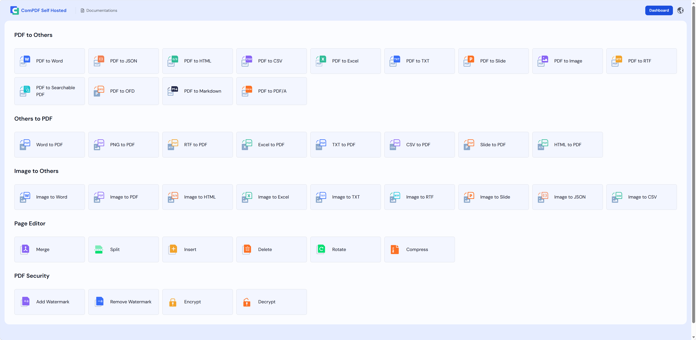
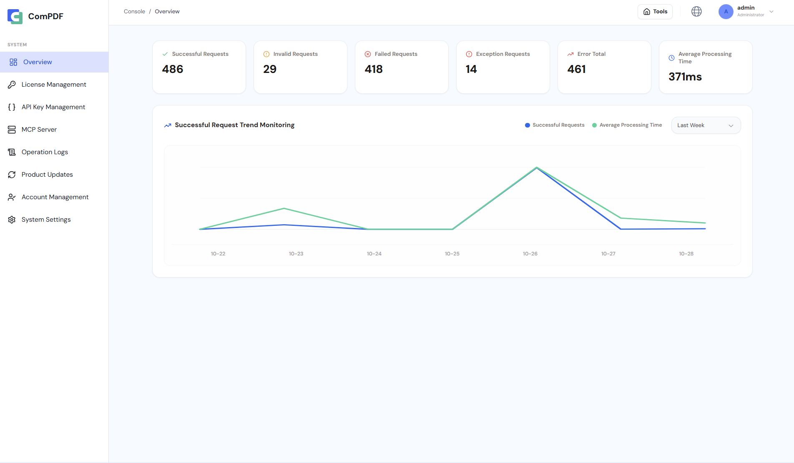

[English](README.md) | [简体中文](README_CN.md) | [繁體中文](README_TW.md)

# ComPDF Self-Hosted — 自托管 PDF 平台

在自己的环境中部署 PDF 编辑、文档转换与批量处理服务，提供 Web 工具中心、
Dashboard 管理后台、REST API 和 MCP 接入。

## 功能

- PDF 工具：合并、拆分、旋转、插入／删除／提取页面、压缩、水印、加密／解密、
  页眉页脚与贝茨码。
- 文档与图片转换：PDF、Office、HTML、文本及支持的图片格式。实际能力取决于
  App 镜像与 SDK 授权。
- 批量文件上传、逐文件密码、顺序处理、状态查询、失败重试与 ZIP 下载。
- Dashboard：用量概览、日志、API 密钥、账号与品牌设置、License 管理及产品更新。
- MCP：使用 API Key 鉴权的 Streamable HTTP 工具，支持操作发现和批次管理。





## 安装部署

以下三种部署方式均受支持。建议至少 **32 GB 内存**，并预留镜像、数据与备份空间。
默认 Infra/App 镜像面向 `linux/amd64`。Docker 方式需要 Docker Engine 或 Linux
容器模式的 Docker Desktop，以及支持 `up --wait --wait-timeout` 的 Compose v2。

### 方式一：脚本安装（免克隆）

适用于 Linux、WSL 或 macOS。在可写目录执行；需提前安装 Bash、curl 与 Docker，
无需 Git 或 Node.js。默认安装目录为 `./compdf-self-hosted`：

```sh
curl -fsSL https://raw.githubusercontent.com/ComPDFKit/compdf-self-hosted/main/deploy/install.sh | bash -s -- --prepare-only
```

如需先审阅脚本或指定目录：

```sh
curl -fsSL https://raw.githubusercontent.com/ComPDFKit/compdf-self-hosted/main/deploy/install.sh -o compdf-install.sh
# 审阅脚本后执行；当前用户需对 /opt 有写权限。
bash compdf-install.sh --dir /opt/compdf --prepare-only
```

安装器将下载文件固定到同一源码提交，准备最小部署文件及配置、字体、数据目录。
`--prepare-only` 只准备文件，便于启动前填写配置；`--dry-run` 仅显示计划。
可用 `--ref` 指定已存在的发布标签或源码提交。镜像使用配置中的 tag；受控部署
建议改为经过验证的 digest。

启动前，将已签发的试用或正式授权文件放到安装目录下的
`configs/app-license/license.xml`。该目录会自动挂载到 App，仓库本身不包含有效的
SDK 授权。合法字体放到 `fonts/windows/`。首次安装也可用 `--sdk-license-dir`
导入包含 `license.xml` 的目录，用 `--fonts-dir` 导入字体。

从默认安装目录的父目录执行：

```sh
# 启动服务或重新应用已配置的环境变量。
bash ./compdf-self-hosted/install.sh install --dir ./compdf-self-hosted
bash ./compdf-self-hosted/install.sh status --dir ./compdf-self-hosted
bash ./compdf-self-hosted/install.sh logs --dir ./compdf-self-hosted
# 停止服务，保留配置与数据。
bash ./compdf-self-hosted/install.sh stop --dir ./compdf-self-hosted
```

若使用 `/opt/compdf`，同时改用 `/opt/compdf/install.sh` 和 `--dir /opt/compdf`。
重复安装会保留已有文件与数据，重新拉取当前配置的镜像，不会更新部署脚本或回滚数据库。
后续使用保存的安装器命令，保持其 Compose 项目标识。更换版本前应一并备份数据库、
存储、配置和授权文件。

### 方式二：Apple container

适用于 Apple Silicon Mac，需要 macOS 26+、Apple `container` 1.5.0、jq 和 curl。
默认 amd64 镜像依赖 Rosetta。使用同一安装器并选择 Apple 运行时：

```sh
curl -fsSL https://raw.githubusercontent.com/ComPDFKit/compdf-self-hosted/main/deploy/install.sh | bash -s -- --runtime apple --prepare-only
```

在准备好的安装目录中放入 `configs/app-license/license.xml`，再执行下方 `install`
命令。安装器按 Infra → App → Server
顺序启动，检查健康状态并注入依赖 IP。配置保存在 `.apple.env`，默认入口仅供本机通过
`http://localhost:8080` 访问。后续命令需添加 `--runtime apple`：

```sh
bash ./compdf-self-hosted/install.sh install --runtime apple --dir ./compdf-self-hosted
bash ./compdf-self-hosted/install.sh status --runtime apple --dir ./compdf-self-hosted
bash ./compdf-self-hosted/install.sh logs --runtime apple --dir ./compdf-self-hosted
bash ./compdf-self-hosted/install.sh stop --runtime apple --dir ./compdf-self-hosted
```

已有容器不会自动覆盖；重建时需刷新依赖 IP，并保留持久化卷。此模式不接入 Docker
Updater，也不提供自动重启守护。停止后需按依赖顺序重建三个容器以刷新 IP。
从 `.apple.env` 读取 `PROJECT`，用 `container delete` 仅删除该项目已停止的容器，
再执行保存的安装命令。保留原网络、命名卷及挂载的配置和存储目录。

### 方式三：手动 Docker Compose

适合需要完整仓库文件或自定义 Compose 的部署：

```sh
git clone https://github.com/ComPDFKit/compdf-self-hosted.git
cd compdf-self-hosted
cp .env.example .env
mkdir -p configs/app-license fonts/windows data/server-storage
```

按照方式一配置 `.env`、镜像版本、已签发授权与字体后启动：

```sh
docker compose --env-file .env config --quiet
docker compose --env-file .env pull
docker compose --env-file .env up -d --wait --wait-timeout 600
docker compose --env-file .env ps
```

修改环境变量后需执行 `docker compose up -d` 重新创建受影响的容器。后续操作保持原
Compose 项目名并保留持久化卷。基础 Compose 发布 8080 端口，可能监听所有主机网络接口。
首次创建容器使用 `up`；`start` 只能恢复已经存在的容器。

### 访问与首次配置

| 入口 | 默认地址 |
| --- | --- |
| ComPDF Web | `http://localhost:8080/` |
| Dashboard | `http://localhost:8080/admin` |
| 健康状态 | `http://localhost:8080/api/v1/status` |

远程 Docker 主机请将 `localhost` 替换为受控入口。首次初始化账号为 `admin / admin`，
登录后请修改密码。对外使用前配置 HTTPS、CORS 与访问控制。
真实授权、密钥、字体与运行数据不提交 Git。

## 产品更新：GitHub 与 Docker Hub

客户端检查本仓库的签名 stable 更新源。只有发布了更高产品版本才提示升级，普通源码
提交不会直接触发安装。经校验与管理员确认后，Updater 从 Docker Hub 拉取固定 digest
的 App／Server 镜像，备份数据、执行声明的数据库迁移、重启并验证真实 PDF 处理。

更新源缺失、无法访问或清单过期时，不会确认为检查成功。安装前由 Updater 独立验证签名。

Dashboard 安装产品更新和在线更新运行 XML License，需要独立 Updater。复制
`.env.example` 为 `.env` 后，模板已包含当前 stable 更新源的
`COMPDF_UPDATE_KEY_ID` 和 Base64 Ed25519 公钥 `COMPDF_UPDATE_PUBLIC_KEY`。
只有签名密钥更换时才需要修改。默认更新源为本仓库 `updates` 分支。在完整仓库中使用已发布镜像启动：

```sh
docker compose -f docker-compose.yml -f docker-compose.updater-container.yml up -d --wait --wait-timeout 600
```

免克隆 Docker 安装可从记录的源码提交下载此覆盖文件，沿用 `.compdf-install` 中
保存的项目名。后续 Compose 操作同时指定该项目名、环境文件和两个 Compose 文件。
此 Docker 覆盖文件不适用于 Apple container。

本地源码构建并启用 Updater，可执行
`docker compose -f docker-compose.full.yml up -d --build --wait --wait-timeout 600`。
安装仍由管理员确认。应用更新器管理 App／Server；Updater 与 Infra 独立部署。
Updater 启动前必须填写上述两个验签配置；基础安装和本地源码开发可不启用 Updater。

升级前备份数据库、存储、配置及授权文件，不要删除持久化卷或改写数据库版本历史。
产品更新后，业务服务使用 `docker compose -f tmp/runtime-updater/docker-compose.json up -d`
按已安装版本重新启动；Updater 沿用原 Compose 配置。重新构建旧源码可能覆盖已安装的更新。

维护者通过 [.github/workflows/release.yml](.github/workflows/release.yml) 中的
**Publish release** 工作流发布。在其 `release` 环境中配置机密 `DOCKERHUB_USERNAME`、
`DOCKERHUB_TOKEN`、`RELEASE_SIGNING_PRIVATE_KEY`（Base64 编码的 64 字节 Ed25519 私钥），
以及变量 `RELEASE_SIGNING_KEY_ID`。向安装环境提供对应的 Base64 编码 32 字节公钥及密钥标识，
私钥保留在发布环境。统一 `release/version.json` 等版本配置，创建不可变的版本标签后，
针对该标签手动运行工作流。工作流发布 Server/UI、Updater 镜像，并在 `updates` 分支生成
`stable/release.json` 与签名 `stable/release.json.sig`。只推送源码不会创建更新源或 Docker Hub 镜像标签。

## 运行组件与源码结构

Infra 提供 MySQL、Redis 和对象存储；App 运行 PDF／转换 SDK；Server 提供接口、
批量任务、MCP 和打包前端；可选 Updater 执行经确认的更新。本仓库不包含商业 SDK 源码。

| 路径 | 用途 |
| --- | --- |
| `frontend/compdf-web/` | Vue 3 + Vite 工具中心与 Dashboard |
| `server/` | NestJS + TypeScript 后端 |
| `updater/` | Go 更新器、发布器与容器启动逻辑 |
| `deploy/`, `helm/` | 实际维护的部署工具 |
| `deployment/`, `release/`, `migrations/` | 配置规范、版本与正式迁移 |
| `configs/` | 运行设置与初始数据库 SQL |
| `tests/fixtures/` | 自动化测试样本，不能作为发布数据 |

## 源码开发

使用 Node.js 24 和 npm，前后端分别维护 package 与锁文件。

```sh
test -f .env || cp .env.example .env
docker compose -f docker-compose.dev.yml up -d --build compdf-infra compdf-app compdf-server
```

另开终端启动前端：

```sh
cd frontend/compdf-web
npm ci
npm run dev
```

前端：`http://localhost:5173`；后端：`http://localhost:8080`。开发配置开放额外
SDK／数据库端口，仅用于隔离环境。Windows 已有本地容器栈时，可运行
`scripts/start-backend-dev.ps1` 启用后端 watch。

在完整仓库根目录构建并部署 Server/UI 镜像：

```sh
docker compose -f docker-compose.yml -f docker-compose.build.yml up -d --build compdf-infra compdf-app compdf-server
```

App 与 Infra 仍使用配置中的镜像。这些源码命令仅适用于完整仓库，不适用于安装器
生成的最小安装目录。

## 其他部署文件

| 方案 | 适用场景 | 文件 |
| --- | --- | --- |
| Kubernetes / Helm | 使用随附 Chart 进行集群部署 | [Chart](helm/compdf-self-hosted/) |
| 源码／二进制 | Linux Server/UI 受控部署；App/Infra 独立提供 | [打包脚本](deploy/binary/) |
| Nginx / Keepalived | TLS 与入口可用性；应用与数据高可用需单独设计 | [入口配置](deploy/nginx/) |
| 离线交付 | 镜像导出与签名离线安装包 | [离线工具](deploy/offline/) |

Nginx 属于入口层；在线／离线属于交付方式，可以与 Compose 或 Kubernetes 组合使用。
Compose 更新器不管理 Kubernetes 或 Apple container。

## 许可与支持

仓库代码采用 [MIT](LICENSE) 协议。商业 PDF／Conversion SDK、有效授权和客户字体
另行提供。产品与企业支持请访问 [ComPDF](https://www.compdf.com/self-hosted-deployment)
或[联系销售](https://www.compdf.com/contact-sales)，代码问题可提交
[GitHub Issues](https://github.com/ComPDFKit/compdf-self-hosted/issues)。
