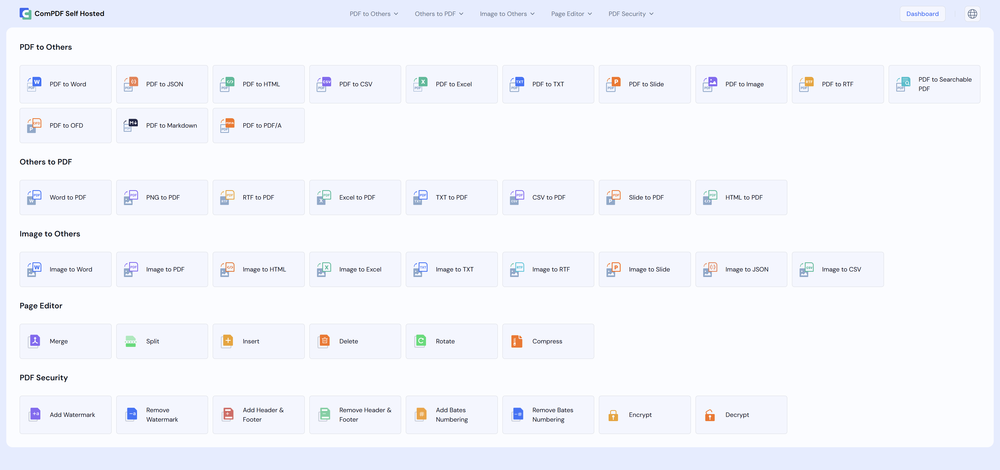
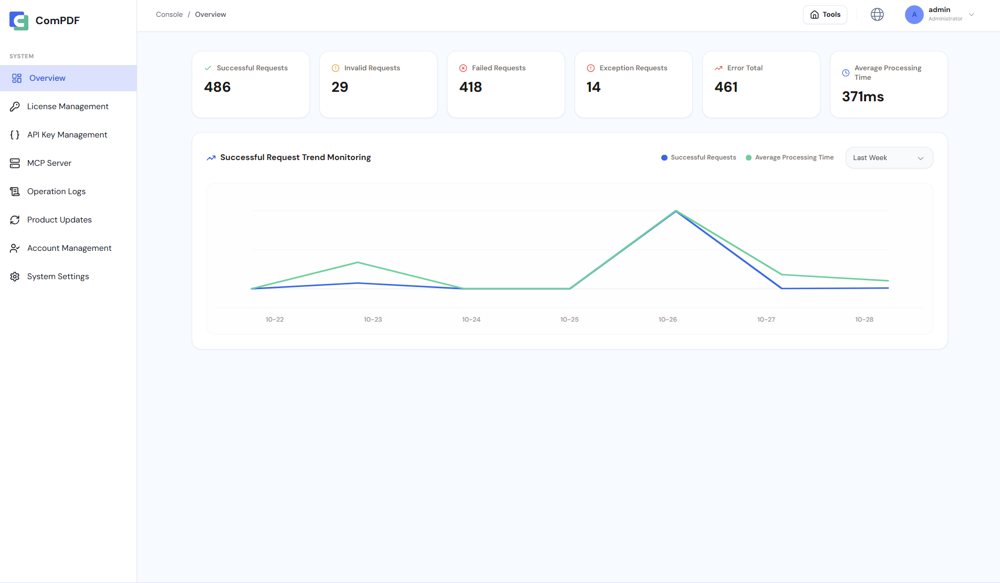

[English](README.md) | [繁體中文](README_TW.md) | [简体中文](README_CN.md)

# ComPDF Self-Hosted — 开源 PDF 编辑器与 PDF 转换器

作为 KDAN 生态的一部分，[ComPDF Self-Hosted](https://www.compdf.com/self-hosted-deployment?utm_source=github_ai_selfhosted_oldopen_zh&utm_medium=referral&utm_campaign=github_ai_selfhosted_oldopen_zh&ref_platform_id=github_compdf_zh) 提供自托管 PDF 编辑与文档转换能力，帮助团队在私有 Docker 环境中安全处理 PDF、Office 文件与图片。

> - 如果您觉得 ComPDF Self-Hosted 实用，请考虑在 GitHub 上为我们点一颗 ⭐ **Star**，这有助于我们成长与改进。
> - 有任何问题或想法？欢迎加入我们的 [Discussions](https://github.com/ComPDFKit/compdf-self-hosted/discussions) 讨论。

<p align="center">
  <a href="LICENSE"></a>
  <a href="#quick-start"></a>
  <a href="https://github.com/ComPDFKit/compdf-self-hosted"></a>
  <a href="https://github.com/ComPDFKit/compdf-self-hosted/pulls"></a>
</p>

<p align="center">
  <a href="#features"><b>功能支持</b></a> •
  <a href="#quick-start"><b>快速开始</b></a> •
  <a href="#architecture"><b>系统架构</b></a> •
  <a href="#upgrade-to-enterprise"><b>升级至企业版</b></a> •
  <a href="#documentation"><b>文档</b></a> •
  <a href="#support"><b>支持</b></a> •
  <a href="#license"><b>许可协议</b></a>
</p>

## 为什么选择 ComPDF Self-Hosted？

不同于需要深度集成的传统 SDK，ComPDF 自托管版是一个可直接部署的开源 PDF 处理平台。它集 PDF 编辑、转换于一身，同时支持图像转换处理，让企业快速拥有自主可控的文档中心。

### 主要优势

* Docker Compose 部署
* 完整的 PDF 工具中心——编辑、转换、合并、拆分
* API 密钥管理与许可证管理
* 私有部署，架构符合企业级标准
* 提供商业支持与专属技术支持

无论您正在搭建内部文档平台、文档自动化流程还是企业 PDF 服务，ComPDF Self-Hosted 都能让您在几分钟内快速上手。

<a id="features"></a>

## 功能支持



ComPDF Self-Hosted 提供可直接在浏览器中使用的**开源 PDF 编辑器**、**开源 PDF 转换器**与**开源图片转换器**中心。

| 功能类别       | 功能详情                                                                        |
| ---------- | --------------------------------------------------------------------------- |
| 批量处理       | 支持批量上传并处理文件                                                                 |
| MCP Server | 支持 MCP 形式串接第三方 Agent 平台进行文件处理                                               |
| PDF 编辑     | 合并、拆分、旋转、插入、删除、以及提取 PDF 页面、压缩 PDF文件                                         |
| PDF 安全     | 给PDF 文件添加水印、移除水印、加密、解密、添加页眉页脚、移除页眉页脚、添加贝茨码、移除贝茨码                            |
| PDF 转其他格式  | Word、Excel、PowerPoint、图片、HTML、TXT、CSV、RTF、JSON、可搜索 PDF、OFD、Markdown 与 PDF/A |
| 其他格式转 PDF  | Word、Excel、PowerPoint、HTML、TXT、CSV、RTF 与 PNG                                |
| 图片转其他格式    | Word、Excel、PowerPoint、HTML、CSV、TXT、RTF、JSON 与 PDF                           |

可用格式与处理限制取决于部署的 App 镜像和 SDK 授权。仓库代码开源；商业 PDF／Conversion SDK 与有效运行许可证单独提供。

### Dashboard 控制台

ComPDF Self-Hosted 提供统一管理控制台，用于查看 API Key、API 调用情况与 License 状态，并支持操作日志审计、账号管理及系统基础配置等核心功能。

使用初始密码和账号即可登录您的 Dashboard，登录后请更改用户名和密码再进行使用

- 初始账号：admin

- 初始密码：admin



* 概览面板：展示 API Key 详情、API 调用统计、License 授权范围及使用状态等信息
* License 管理：查看本产品的 License 文件、运行状态及版本权限；支持一键替换 License 文件并完成产品升级
* API Key 管理：查看并复制您的 API Key 和运行状态，以授权第三方系统、服务或 Agents 调用 API 进行文档处理
* MCP Server：获取各 Agent 平台的配置代码以及 API Key，以串接 Agent 平台，赋能您的 AI 专业的 PDF 处理能力
* 操作日志：跟踪、搜索并导出所有操作日志
* 产品更新：检查最新版本详细、下载新版本并启用
* 账号管理：设置用户名和密码
* 系统设置：配置系统名称、Logo 和主题色

### 批量处理与 API 集成

- 批量文件上传、逐文件密码、顺序处理、状态查询、失败重试与 ZIP 下载。
- REST API：对接内部系统与文档自动化流程。
- MCP：使用 API Key 鉴权的 Streamable HTTP 工具，支持操作发现和批次管理。

<a id="quick-start"></a>

## 快速开始

以下三种部署方式均受支持。请预留镜像、数据与备份空间。
默认 Infra/App 镜像面向 `linux/amd64`。Docker 方式需要 Docker Engine 或 Linux
容器模式的 Docker Desktop，以及支持 `up --wait --wait-timeout` 的 Compose v2。**部署中 License 会为您自动生成，无需您提供，若要升级为付费版本可[联系销售](https://www.compdf.com/contact-sales?utm_source=github_ai_selfhosted_oldopen_zh&utm_medium=referral&utm_campaign=github_ai_selfhosted_oldopen_zh&ref_platform_id=github_compdf_zh)进行购买并在 Dashboard 的 License 管理模块替换即可。**

### 方式一：脚本安装（免克隆）

适用于 Linux、WSL 或 macOS。在可写目录执行；需提前安装 Bash、curl 与 Docker，
无需 Git 或 Node.js。默认安装目录为 `./compdf-self-hosted`：

```sh
curl -fsSL https://raw.githubusercontent.com/ComPDFKit/compdf-self-hosted/main/deploy/install.sh | bash -s -- --prepare-only
```

如需先审阅脚本或指定目录：

```sh
curl -fsSL https://raw.githubusercontent.com/ComPDFKit/compdf-self-hosted/main/deploy/install.sh -o compdf-install.sh
# 审阅脚本后执行；当前用户需对 /opt 有写权限。
bash compdf-install.sh --dir /opt/compdf --prepare-only
```

安装器将下载文件固定到同一源码提交，准备最小部署文件及配置、字体、数据目录。
`--prepare-only` 只准备文件，便于启动前填写配置；`--dry-run` 仅显示计划。
可用 `--ref` 指定已存在的发布标签或源码提交。镜像使用配置中的 tag；受控部署
建议改为经过验证的 digest。

启动前，将已签发的试用或正式授权文件放到安装目录下的
`configs/app-license/license.xml`。该目录会自动挂载到 App，仓库本身不包含有效的
SDK 授权。合法字体放到 `fonts/windows/`。首次安装也可用 `--sdk-license-dir`
导入包含 `license.xml` 的目录，用 `--fonts-dir` 导入字体。

从默认安装目录的父目录执行：

```sh
# 启动服务或重新应用已配置的环境变量。
bash ./compdf-self-hosted/install.sh install --dir ./compdf-self-hosted
bash ./compdf-self-hosted/install.sh status --dir ./compdf-self-hosted
bash ./compdf-self-hosted/install.sh logs --dir ./compdf-self-hosted
# 停止服务，保留配置与数据。
bash ./compdf-self-hosted/install.sh stop --dir ./compdf-self-hosted
```

若使用 `/opt/compdf`，同时改用 `/opt/compdf/install.sh` 和 `--dir /opt/compdf`。
重复安装会保留已有文件与数据，重新拉取当前配置的镜像，不会更新部署脚本或回滚数据库。
后续使用保存的安装器命令，保持其 Compose 项目标识。更换版本前应一并备份数据库、
存储、配置和授权文件。

### 方式二：Apple container

适用于 Apple Silicon Mac，需要 macOS 26+、Apple `container` 1.5.0、jq 和 curl。
默认 amd64 镜像依赖 Rosetta。使用同一安装器并选择 Apple 运行时：

```sh
curl -fsSL https://raw.githubusercontent.com/ComPDFKit/compdf-self-hosted/main/deploy/install.sh | bash -s -- --runtime apple --prepare-only
```

在准备好的安装目录中放入 `configs/app-license/license.xml`，再执行下方 `install`
命令。安装器按 Infra → App → Server
顺序启动，检查健康状态并注入依赖 IP。配置保存在 `.apple.env`，默认入口仅供本机通过
`http://localhost:8080` 访问。后续命令需添加 `--runtime apple`：

```sh
bash ./compdf-self-hosted/install.sh install --runtime apple --dir ./compdf-self-hosted
bash ./compdf-self-hosted/install.sh status --runtime apple --dir ./compdf-self-hosted
bash ./compdf-self-hosted/install.sh logs --runtime apple --dir ./compdf-self-hosted
bash ./compdf-self-hosted/install.sh stop --runtime apple --dir ./compdf-self-hosted
```

已有容器不会自动覆盖；重建时需刷新依赖 IP，并保留持久化卷。此模式不接入 Docker
Updater，也不提供自动重启守护。停止后需按依赖顺序重建三个容器以刷新 IP。
从 `.apple.env` 读取 `PROJECT`，用 `container delete` 仅删除该项目已停止的容器，
再执行保存的安装命令。保留原网络、命名卷及挂载的配置和存储目录。

### 方式三：手动 Docker Compose

适合需要完整仓库文件或自定义 Compose 的部署：

```sh
git clone https://github.com/ComPDFKit/compdf-self-hosted.git
cd compdf-self-hosted
cp .env.example .env
mkdir -p configs/app-license fonts/windows data/server-storage
```

按照方式一配置 `.env`、镜像版本、已签发授权与字体后启动：

```sh
docker compose --env-file .env config --quiet
docker compose --env-file .env pull
docker compose --env-file .env up -d --wait --wait-timeout 600
docker compose --env-file .env ps
```

修改环境变量后需执行 `docker compose up -d` 重新创建受影响的容器。后续操作保持原
Compose 项目名并保留持久化卷。基础 Compose 发布 8080 端口，可能监听所有主机网络接口。
首次创建容器使用 `up`；`start` 只能恢复已经存在的容器。

### 访问与首次配置

| 入口         | 默认地址                                  |
| ---------- | ------------------------------------- |
| ComPDF Web | `http://localhost:8080/`              |
| Dashboard  | `http://localhost:8080/admin`         |
| 健康状态       | `http://localhost:8080/api/v1/status` |

远程 Docker 主机请将 `localhost` 替换为受控入口。首次初始化账号为 `admin / admin`，
登录后请修改密码。对外使用前配置 HTTPS、CORS 与访问控制。
真实授权、密钥、字体与运行数据不提交 Git。

## 产品更新：GitHub 与 Docker Hub

客户端检查本仓库的签名 stable 更新源。只有发布了更高产品版本才提示升级，普通源码
提交不会直接触发安装。经校验与管理员确认后，Updater 从 Docker Hub 拉取固定 digest
的 App/Server 镜像，备份数据、执行声明的数据库迁移、重启并验证真实 PDF 处理。

更新源缺失、无法访问或清单过期时，不会确认为检查成功。安装前由 Updater 独立验证签名。

Dashboard 安装产品更新和在线更新运行 XML License 使用默认 Compose 文件中包含的 Updater。复制
`.env.example` 为 `.env` 后，模板已包含当前 stable 更新源的
`COMPDF_UPDATE_KEY_ID` 和 Base64 Ed25519 公钥 `COMPDF_UPDATE_PUBLIC_KEY`。
只有签名密钥更换时才需要修改。默认更新源为本仓库 `updates` 分支。在完整仓库中启动全部服务：

```sh
docker compose --env-file .env pull
docker compose --env-file .env up -d --wait --wait-timeout 600
```

免克隆 Docker 安装可继续使用记录的覆盖文件和 `.compdf-install` 中保存的项目名。
新的完整仓库不需要额外覆盖文件；旧的 `docker-compose.updater-container.yml` 仍保留用于兼容。

本地源码构建可执行
`docker compose -f docker-compose.full.yml up -d --build --wait --wait-timeout 600`。
安装仍由管理员确认。默认 Compose 命令会同时启动应用、Updater 与 Infra。

升级前备份数据库、存储、配置及授权文件，不要删除持久化卷或改写数据库版本历史。
产品更新后，业务服务使用 `docker compose -f tmp/runtime-updater/docker-compose.json up -d`
按已安装版本重新启动；Updater 沿用原 Compose 配置。重新构建旧源码可能覆盖已安装的更新。

维护者通过 [.github/workflows/release.yml](.github/workflows/release.yml) 中的
**Publish release** 工作流发布。在其 `release` 环境中配置机密 `DOCKERHUB_USERNAME`、
`DOCKERHUB_TOKEN`、`RELEASE_SIGNING_PRIVATE_KEY`（Base64 编码的 64 字节 Ed25519 私钥），
以及变量 `RELEASE_SIGNING_KEY_ID`。向安装环境提供对应的 Base64 编码 32 字节公钥及密钥标识，
私钥保留在发布环境。统一 `release/version.json` 等版本配置，创建不可变的版本标签后，
针对该标签手动运行工作流。工作流发布 Server/UI、Updater 镜像，并在 `updates` 分支生成
`stable/release.json` 与签名 `stable/release.json.sig`。只推送源码不会创建更新源或 Docker Hub 镜像标签。

<a id="architecture"></a>

## 系统架构

Infra 提供 MySQL、Redis 和对象存储；App 运行 PDF／转换 SDK；Server 提供接口、
批量任务、MCP 和打包前端；可选 Updater 执行经确认的更新。本仓库不包含商业 SDK 源码。

| 路径                                       | 用途                           |
| ---------------------------------------- | ---------------------------- |
| `frontend/compdf-web/`                   | Vue 3 + Vite 工具中心与 Dashboard |
| `server/`                                | NestJS + TypeScript 后端       |
| `updater/`                               | Go 更新器、发布器与容器启动逻辑            |
| `deploy/`, `helm/`                       | 实际维护的部署工具                    |
| `deployment/`, `release/`, `migrations/` | 配置规范、版本与正式迁移                 |
| `configs/`                               | 运行设置与初始数据库 SQL               |

## 源码开发

使用 Node.js 24 和 npm，前后端分别维护 package 与锁文件。

```sh
test -f .env || cp .env.example .env
docker compose -f docker-compose.dev.yml up -d --build compdf-infra compdf-app compdf-server
```

另开终端启动前端：

```sh
cd frontend/compdf-web
npm ci
npm run dev
```

前端：`http://localhost:5173`；后端：`http://localhost:8080`。开发配置开放额外
SDK／数据库端口，仅用于隔离环境。Windows 已有本地容器栈时，可运行
`scripts/start-backend-dev.ps1` 启用后端 watch。

在完整仓库根目录构建并部署 Server/UI 镜像：

```sh
docker compose -f docker-compose.yml -f docker-compose.build.yml up -d --build compdf-infra compdf-app compdf-server
```

App 与 Infra 仍使用配置中的镜像。这些源码命令仅适用于完整仓库，不适用于安装器
生成的最小安装目录。

## 其他部署文件

| 方案                 | 适用场景                                | 文件                                |
| ------------------ | ----------------------------------- | --------------------------------- |
| Kubernetes / Helm  | 使用随附 Chart 进行集群部署                   | [Chart](helm/compdf-self-hosted/) |
| 源码／二进制             | Linux Server/UI 受控部署；App/Infra 独立提供 | [打包脚本](deploy/binary/)            |
| Nginx / Keepalived | TLS 与入口可用性；应用与数据高可用需单独设计            | [入口配置](deploy/nginx/)             |
| 离线交付               | 镜像导出与签名离线安装包                        | [离线工具](deploy/offline/)           |

Nginx 属于入口层；在线／离线属于交付方式，可以与 Compose 或 Kubernetes 组合使用。
Compose 更新器不管理 Kubernetes 或 Apple container。

<a id="upgrade-to-enterprise"></a>

## 升级至企业版

实际功能、页数限制与并发数以签发的许可证及商业协议为准；部署前请联系销售确认。

[联系销售](https://www.compdf.com/contact-sales?utm_source=github_ai_selfhosted_oldopen_zh&utm_medium=referral&utm_campaign=github_ai_selfhosted_oldopen_zh&ref_platform_id=github_compdf_zh)  升级至 **Enterprise 版**

| 功能     | 免费版 | 企业版 |
| ------ | --- | --- |
| PDF 编辑 | ✅   | ✅   |
| PDF 转换 | ✅   | ✅   |
| Web 界面 | ✅   | ✅   |
| 仪表板    | ✅   | ✅   |
| 批量文件处理 | ✅   |     |
| 无水印输出  | ❌   | ✅   |
| 不限制页数  | ❌   | ✅   |
| 自定义并发数 | ❌   | ✅   |
| 商业许可证  | ❌   | ✅   |
| 技术支持   | ❌   | ✅   |

<a id="documentation"></a>

## 文档

- SDK 文档：[https://www.compdf.com/guides/pdf-sdk/self-hosted-deployment/overview](https://www.compdf.com/guides/pdf-sdk/self-hosted-deployment/overview?utm_source=github_ai_selfhosted_oldopen_zh&utm_medium=referral&utm_campaign=github_ai_selfhosted_oldopen_zh&ref_platform_id=github_compdf_zh)

- API Reference：[https://www.compdf.com/guides/pdf-sdk/self-hosted-deployment/api-reference-conversion](https://www.compdf.com/guides/pdf-sdk/self-hosted-deployment/api-reference-conversion?utm_source=github_ai_selfhosted_oldopen_zh&utm_medium=referral&utm_campaign=github_ai_selfhosted_oldopen_zh&ref_platform_id=github_compdf_zh)

<a id="support"></a>

## 支持

代码问题请提交 [GitHub Issues](https://github.com/ComPDFKit/compdf-self-hosted/issues)。

有任何建议？[发起讨论](https://github.com/ComPDFKit/compdf-self-hosted/discussions)。如果您觉得 **ComPDF Self-Hosted** 实用，请考虑在 GitHub 上为我们点一颗 ⭐ **Star**，这有助于我们成长与改进。

<a id="license"></a>

## 许可协议

仓库代码采用 [MIT](LICENSE) 协议。商业 PDF／Conversion SDK、有效授权和客户字体
另行提供。产品与企业支持请访问 [ComPDF](https://www.compdf.com/self-hosted-deployment)
或[联系销售](https://www.compdf.com/contact-sales)，代码问题可提交
[GitHub Issues](https://github.com/ComPDFKit/compdf-self-hosted/issues)。

---

<p align="center">
  <b>ComPDF 团队打造</b><br>
  <a href="https://compdf.com?utm_source=github_ai_selfhosted_oldopen_zh&utm_medium=referral&utm_campaign=github_ai_selfhosted_oldopen_zh&ref_platform_id=github_compdf_zh">官网</a> ·
  <a href="https://www.compdf.com/guides/pdf-sdk/self-hosted-deployment/overview?utm_source=github_ai_selfhosted_oldopen_zh&utm_medium=referral&utm_campaign=github_ai_selfhosted_oldopen_zh&ref_platform_id=github_compdf_zh">技术文档</a> ·
  <a href="https://www.compdf.com/contact-sales?utm_source=github_ai_selfhosted_oldopen_zh&utm_medium=referral&utm_campaign=github_ai_selfhosted_oldopen_zh&ref_platform_id=github_compdf_zh">企业咨询</a>
</p>
