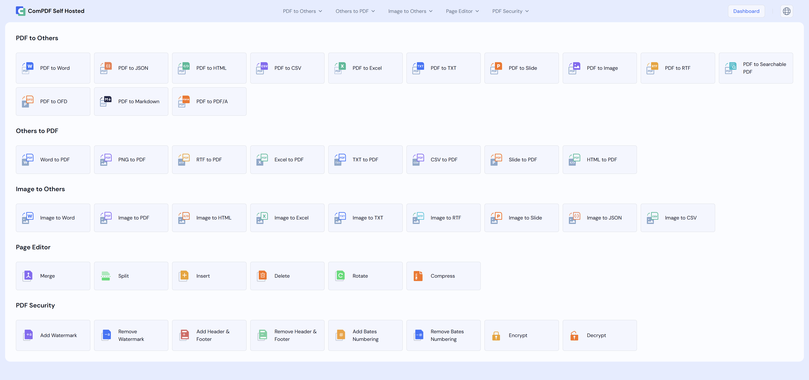
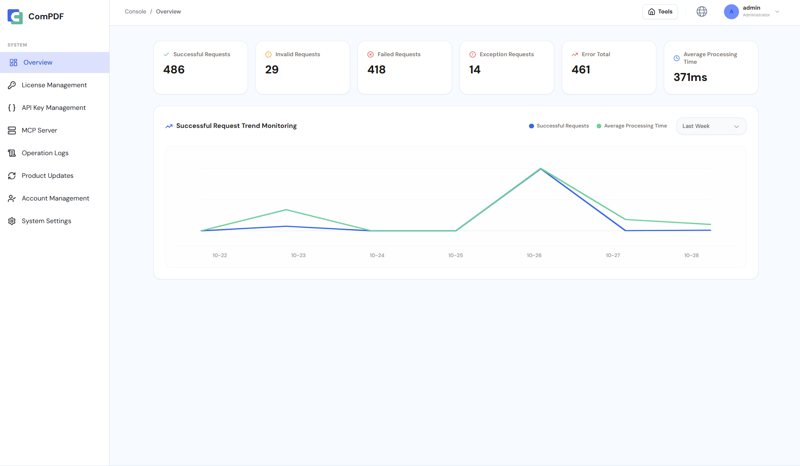

[English](README.md) | [繁體中文](README_TW.md) | [简体中文](README_CN.md)

# ComPDF Self-Hosted — 開源 PDF 編輯器與 PDF 轉檔工具

[ComPDF Self-Hosted](https://www.compdf.com/self-hosted-deployment?utm_source=github_ai_selfhosted_oldopen_tw&utm_medium=referral&utm_campaign=github_ai_selfhosted_oldopen_tw&ref_platform_id=github_compdf_tw) 是 KDAN 生態系的一部分，提供可私有化部署的 PDF 編輯與轉檔功能，幫助團隊在私有 Docker 環境中安全處理 PDF、Office 文件與圖片。

> * 如果您覺得 ComPDF Self-Hosted 實用，請考慮在 GitHub 上為我們點亮一顆 ⭐ **Star**，支持我們持續成長與改進。
> * 有任何問題或想法？歡迎前往 [Discussions](https://github.com/ComPDFKit/compdf-self-hosted/discussions) 與我們交流。

<p align="center">
  <a href="LICENSE"></a>
  <a href="#quick-start"></a>
  <a href="https://github.com/ComPDFKit/compdf-self-hosted"></a>
  <a href="https://github.com/ComPDFKit/compdf-self-hosted/pulls"></a>
</p>

<p align="center">
  <a href="#features"><b>功能</b></a> •
  <a href="#quick-start"><b>快速開始</b></a> •
  <a href="#architecture"><b>系統架構</b></a> •
  <a href="#upgrade-to-enterprise"><b>升級至企業版</b></a> •
  <a href="#documentation"><b>技術文件</b></a> •
  <a href="#support"><b>支援</b></a> •
  <a href="#license"><b>授權條款</b></a>
</p>

## 為什麼選擇 ComPDF Self-Hosted？

不同於需要深度整合的傳統 SDK，ComPDF Self-Hosted 是一套可直接部署的開源 PDF 處理平台。平台整合 PDF 編輯、文件轉檔與圖片轉檔功能，涵蓋完整的文件與圖片處理需求，讓企業能快速建置自主可控的文件處理中心。

### 主要優勢

* 支援 Docker Compose 部署
* 完整的 PDF 工具中心——編輯、轉檔、合併、分割
* 支援 API 金鑰管理與授權管理
* 支援私有化部署，採用符合企業級需求的系統架構
* 提供商業支援與專屬技術協助

無論您正在建置內部文件平台、文件自動化流程或企業 PDF 服務，ComPDF Self-Hosted 都能讓您在幾分鐘內快速上手。

<a id="features"></a>

## 功能



### 1. PDF 工具中心

ComPDF Self-Hosted 提供可直接在瀏覽器中使用的**開源 PDF 編輯器、開源 PDF 轉檔工具與開源圖片轉檔**工具中心。

| 類別 | 功能 |
| --- | --- |
| PDF 編輯 | 合併、分割、旋轉、插入／刪除／擷取頁面、壓縮、新增／移除浮水印、加密／解密、新增／移除頁首／頁尾及貝茲編碼 |
| PDF 轉其他格式 | Word、Excel、PowerPoint、圖片、HTML、TXT、CSV、RTF、JSON、可搜尋 PDF、OFD、Markdown 與 PDF/A |
| 其他格式轉 PDF | Word、Excel、PowerPoint、HTML、TXT、CSV、RTF 與 PNG |
| 圖片轉其他格式 | Word、Excel、PowerPoint、HTML、CSV、TXT、RTF、JSON 與 PDF |

可用格式與處理限制取決於部署的 App 映像和 SDK 授權。儲存庫程式碼開源；商業 PDF／Conversion SDK 與有效執行授權另行提供。

### 2. Dashboard 管理控制台

ComPDF Self-Hosted 提供統一的管理控制台，用於查看 API Key、API 呼叫情況與 License 狀態，並支援操作紀錄稽核、帳號管理及系統基本設定等核心功能。



* 總覽面板：顯示 API Key 詳細資訊、API 呼叫資料、授權（License）範圍及狀態等資訊。
* 操作日誌：追蹤、搜尋，並匯出所有操作日誌
* 帳號管理：設定使用者名稱與密碼
* 系統設定：設定系統名稱、標誌與主題色
* License 管理與產品更新：檢視執行授權狀態，管理經管理員確認的產品更新。

### 3. 批次處理與 API 串接

- 批次檔案上傳、個別檔案密碼、循序處理、狀態查詢、失敗重試與 ZIP 下載。
- REST API：串接內部系統與文件自動化流程。
- MCP：以 API Key 驗證的 Streamable HTTP 工具，支援操作探索與批次管理。

<a id="quick-start"></a>

## 快速開始

以下三種部署方式皆受支援。請預留映像、資料與備份空間。
預設 Infra/App 映像適用於 `linux/amd64`。Docker 方式需要 Docker Engine 或 Linux
容器模式的 Docker Desktop，以及支援 `up --wait --wait-timeout` 的 Compose v2。

### 方式一：指令碼安裝（免複製儲存庫）

適用於 Linux、WSL 或 macOS。在可寫入的目錄執行；需預先安裝 Bash、curl 與 Docker，
無需 Git 或 Node.js。預設安裝目錄為 `./compdf-self-hosted`：

```sh
curl -fsSL https://raw.githubusercontent.com/ComPDFKit/compdf-self-hosted/main/deploy/install.sh | bash -s -- --prepare-only
```

如需先檢閱指令碼或指定目錄：

```sh
curl -fsSL https://raw.githubusercontent.com/ComPDFKit/compdf-self-hosted/main/deploy/install.sh -o compdf-install.sh
# 檢閱指令碼後執行；目前使用者需對 /opt 有寫入權限。
bash compdf-install.sh --dir /opt/compdf --prepare-only
```

安裝器會將下載檔案固定到同一原始碼提交，準備最小部署檔案及設定、字型、資料目錄。
`--prepare-only` 僅準備檔案，方便啟動前填寫設定；`--dry-run` 僅顯示計畫。
可用 `--ref` 指定已存在的發佈標籤或原始碼提交。映像使用設定中的 tag；受控部署
建議改為經過驗證的 digest。

啟動前，將已簽發的試用或正式授權檔案放入安裝目錄下的
`configs/app-license/license.xml`。該目錄會自動掛載到 App，儲存庫本身不包含有效的
SDK 授權。合法字型放入 `fonts/windows/`。首次安裝也可用 `--sdk-license-dir`
匯入包含 `license.xml` 的目錄，用 `--fonts-dir` 匯入字型。

從預設安裝目錄的上層目錄執行：

```sh
# 啟動服務或重新套用已設定的環境變數。
bash ./compdf-self-hosted/install.sh install --dir ./compdf-self-hosted
bash ./compdf-self-hosted/install.sh status --dir ./compdf-self-hosted
bash ./compdf-self-hosted/install.sh logs --dir ./compdf-self-hosted
# 停止服務，保留設定與資料。
bash ./compdf-self-hosted/install.sh stop --dir ./compdf-self-hosted
```

若使用 `/opt/compdf`，同時改用 `/opt/compdf/install.sh` 和 `--dir /opt/compdf`。
重複安裝會保留既有檔案與資料，重新拉取目前設定的映像，不會更新部署指令碼或回復資料庫。
後續使用已儲存的安裝器命令，維持其 Compose 專案識別。更換版本前應一併備份資料庫、
儲存空間、設定與授權檔案。

### 方式二：Apple container

適用於 Apple Silicon Mac，需要 macOS 26+、Apple `container` 1.5.0、jq 和 curl。
預設 amd64 映像依賴 Rosetta。使用同一安裝器並選擇 Apple 執行環境：

```sh
curl -fsSL https://raw.githubusercontent.com/ComPDFKit/compdf-self-hosted/main/deploy/install.sh | bash -s -- --runtime apple --prepare-only
```

在準備好的安裝目錄中放入 `configs/app-license/license.xml`，再執行下方 `install`
命令。安裝器依 Infra → App → Server
順序啟動，檢查健康狀態並注入相依 IP。設定儲存於 `.apple.env`，預設入口僅供本機透過
`http://localhost:8080` 存取。後續命令需加入 `--runtime apple`：

```sh
bash ./compdf-self-hosted/install.sh install --runtime apple --dir ./compdf-self-hosted
bash ./compdf-self-hosted/install.sh status --runtime apple --dir ./compdf-self-hosted
bash ./compdf-self-hosted/install.sh logs --runtime apple --dir ./compdf-self-hosted
bash ./compdf-self-hosted/install.sh stop --runtime apple --dir ./compdf-self-hosted
```

既有容器不會自動覆寫；重建時需更新相依 IP，並保留持久化磁碟區。此模式不串接 Docker
Updater，也不提供自動重啟守護。停止後需依相依順序重建三個容器以更新 IP。
從 `.apple.env` 讀取 `PROJECT`，用 `container delete` 僅刪除該專案已停止的容器，
再執行已儲存的安裝命令。保留原網路、具名磁碟區及掛載的設定與儲存目錄。

### 方式三：手動 Docker Compose

適合需要完整儲存庫檔案或自訂 Compose 的部署：

```sh
git clone https://github.com/ComPDFKit/compdf-self-hosted.git
cd compdf-self-hosted
cp .env.example .env
mkdir -p configs/app-license fonts/windows data/server-storage
```

按照方式一設定 `.env`、映像版本、已簽發授權與字型後啟動：

```sh
docker compose --env-file .env config --quiet
docker compose --env-file .env pull
docker compose --env-file .env up -d --wait --wait-timeout 600
docker compose --env-file .env ps
```

修改環境變數後需執行 `docker compose up -d` 重新建立受影響的容器。後續操作維持原
Compose 專案名稱並保留持久化磁碟區。基礎 Compose 發佈 8080 連接埠，可能監聽所有主機網路介面。
首次建立容器使用 `up`；`start` 只能恢復已經存在的容器。

### 存取與首次設定

| 入口 | 預設位址 |
| --- | --- |
| ComPDF Web | `http://localhost:8080/` |
| Dashboard | `http://localhost:8080/admin` |
| 健康狀態 | `http://localhost:8080/api/v1/status` |

遠端 Docker 主機請將 `localhost` 替換為受控入口。首次初始化帳號為 `admin / admin`，
登入後請修改密碼。對外使用前設定 HTTPS、CORS 與存取控制。
真實授權、金鑰、字型與執行資料不提交 Git。

## 產品更新：GitHub 與 Docker Hub

用戶端檢查本儲存庫的簽章 stable 更新來源。只有發佈更高產品版本才提示升級，一般
原始碼提交不會直接觸發安裝。經驗證與管理員確認後，Updater 從 Docker Hub 拉取固定
digest 的 App／Server 映像，備份資料、執行宣告的資料庫遷移、重啟並驗證實際 PDF 處理。

更新來源缺失、無法存取或清單過期時，不會確認為檢查成功。安裝前由 Updater 獨立驗證簽章。

Dashboard 安裝產品更新與線上更新執行 XML License，使用預設 Compose 檔案中包含的 Updater。將
`.env.example` 複製為 `.env` 後，範本已包含目前 stable 更新來源的
`COMPDF_UPDATE_KEY_ID` 與 Base64 Ed25519 公鑰 `COMPDF_UPDATE_PUBLIC_KEY`。
只有簽章金鑰更換時才需要修改。預設更新來源為本儲存庫 `updates` 分支。在完整儲存庫中啟動全部服務：

```sh
docker compose --env-file .env pull
docker compose --env-file .env up -d --wait --wait-timeout 600
```

免複製儲存庫的 Docker 安裝可繼續使用記錄的覆寫檔案與 `.compdf-install` 儲存的專案名稱。
新的完整儲存庫不需要額外覆寫檔案；舊的 `docker-compose.updater-container.yml` 仍保留以相容既有安裝。

本機原始碼建置可執行
`docker compose -f docker-compose.full.yml up -d --build --wait --wait-timeout 600`。
安裝仍由管理員確認。預設 Compose 指令會同時啟動應用程式、Updater 與 Infra。

升級前備份資料庫、儲存空間、設定與授權檔案，不要刪除持久化磁碟區或改寫資料庫版本歷史。
產品更新後，業務服務使用 `docker compose -f tmp/runtime-updater/docker-compose.json up -d`
依已安裝版本重新啟動；Updater 沿用原 Compose 設定。重新建置舊原始碼可能覆蓋已安裝的更新。

維護者透過 [.github/workflows/release.yml](.github/workflows/release.yml) 中的
**Publish release** 工作流程發佈。在其 `release` 環境中設定機密 `DOCKERHUB_USERNAME`、
`DOCKERHUB_TOKEN`、`RELEASE_SIGNING_PRIVATE_KEY`（Base64 編碼的 64 位元組 Ed25519 私鑰），
以及變數 `RELEASE_SIGNING_KEY_ID`。向安裝環境提供對應的 Base64 編碼 32 位元組公鑰與金鑰識別，
私鑰保留在發佈環境。統一 `release/version.json` 等版本設定，建立不可變的版本標籤後，
針對該標籤手動執行工作流程。工作流程發佈 Server/UI、Updater 映像，並在 `updates` 分支產生
`stable/release.json` 與簽章 `stable/release.json.sig`。只推送原始碼不會建立更新來源或 Docker Hub 映像標籤。

<a id="architecture"></a>

## 系統架構

Infra 提供 MySQL、Redis 與物件儲存；App 執行 PDF／轉換 SDK；Server 提供介面、
批次工作、MCP 與封裝前端；選用 Updater 執行經確認的更新。本儲存庫不包含商業 SDK 原始碼。

| 路徑 | 用途 |
| --- | --- |
| `frontend/compdf-web/` | Vue 3 + Vite 工具中心與 Dashboard |
| `server/` | NestJS + TypeScript 後端 |
| `updater/` | Go 更新器、發佈器與容器啟動邏輯 |
| `deploy/`, `helm/` | 實際維護的部署工具 |
| `deployment/`, `release/`, `migrations/` | 設定規範、版本與正式遷移 |
| `configs/` | 執行設定與初始資料庫 SQL |

## 原始碼開發

使用 Node.js 24 與 npm，前後端分別維護 package 與鎖定檔。

```sh
test -f .env || cp .env.example .env
docker compose -f docker-compose.dev.yml up -d --build compdf-infra compdf-app compdf-server
```

另開終端啟動前端：

```sh
cd frontend/compdf-web
npm ci
npm run dev
```

前端：`http://localhost:5173`；後端：`http://localhost:8080`。開發設定開放額外
SDK／資料庫連接埠，僅供隔離環境。Windows 已有本機容器環境時，可執行
`scripts/start-backend-dev.ps1` 啟用後端 watch。

在完整儲存庫根目錄建置並部署 Server/UI 映像：

```sh
docker compose -f docker-compose.yml -f docker-compose.build.yml up -d --build compdf-infra compdf-app compdf-server
```

App 與 Infra 仍使用設定中的映像。這些原始碼命令僅適用於完整儲存庫，不適用於安裝器
產生的最小安裝目錄。

## 其他部署檔案

| 方案 | 適用情境 | 檔案 |
| --- | --- | --- |
| Kubernetes / Helm | 使用隨附 Chart 進行叢集部署 | [Chart](helm/compdf-self-hosted/) |
| 原始碼／二進位 | Linux Server/UI 受控部署；App/Infra 獨立提供 | [封裝指令碼](deploy/binary/) |
| Nginx / Keepalived | TLS 與入口可用性；應用程式與資料高可用需另行設計 | [入口設定](deploy/nginx/) |
| 離線交付 | 映像匯出與簽章離線安裝包 | [離線工具](deploy/offline/) |

Nginx 屬於入口層；線上／離線屬於交付方式，可以與 Compose 或 Kubernetes 組合使用。
Compose 更新器不管理 Kubernetes 或 Apple container。

<a id="upgrade-to-enterprise"></a>

## 升級至企業版

實際功能、頁數限制與併發數以核發的授權及商業協議為準；部署前請聯絡銷售確認。

[請聯絡銷售團隊](https://www.compdf.com/contact-sales?utm_source=github_ai_seLfhosted_oldopen_tw&utm_medium=referral&utm_campaign=github_ai_seLfhosted_oldopen_tw&ref_platform_id=github_compdf_tw)，將方案升級至 **Enterprise** 版。

| 功能  | 免費版 | 企業版 |
| --- | --- | --- |
| PDF 編輯 | ✅   | ✅   |
| PDF 轉檔 | ✅   | ✅   |
| Web 介面 | ✅   | ✅   |
| Dashboard 管理控制台 | ✅   | ✅   |
| 輸出文件不含浮水印 | ❌   | ✅   |
| 不限制頁數 | ❌   | ✅   |
| 自訂併發數 | ❌   | ✅   |
| 商業授權 | ❌   | ✅   |
| 技術支援 | ❌   | ✅   |

<a id="documentation"></a>

## 技術文件

* 開發文件：[https://www.compdf.com/guides/pdf-sdk/self-hosted-deployment/overview](https://www.compdf.com/guides/pdf-sdk/self-hosted-deployment/overview?utm_source=github_ai_seLfhosted_open_tw&utm_medium=referral&utm_campaign=github_ai_seLfhosted_open_tw&ref_platform_id=github_compdfkit_tw)

* API Reference：[https://www.compdf.com/guides/pdf-sdk/self-hosted-deployment/api-reference-conversion](https://www.compdf.com/guides/pdf-sdk/self-hosted-deployment/api-reference-conversion?utm_source=github_ai_seLfhosted_open_tw&utm_medium=referral&utm_campaign=github_ai_seLfhosted_open_tw&ref_platform_id=github_compdfkit_tw)

<a id="support"></a>

## 支援

程式碼問題請提交 [GitHub Issues](https://github.com/ComPDFKit/compdf-self-hosted/issues)。

有任何建議？[歡迎發起討論](https://github.com/ComPDFKit/compdf-self-hosted/discussions)。如果您覺得 ComPDF Self-Hosted 實用，歡迎在 GitHub 上為我們點亮一顆 ⭐ **Star**，支持我們持續成長與改進。

<a id="license"></a>

## 授權條款

儲存庫程式碼採用 [MIT](LICENSE) 授權。商業 PDF／Conversion SDK、有效授權與客戶字型
另行提供。產品與企業支援請造訪 [ComPDF](https://www.compdf.com/self-hosted-deployment)
或[聯絡銷售](https://www.compdf.com/contact-sales)，程式問題可提交
[GitHub Issues](https://github.com/ComPDFKit/compdf-self-hosted/issues)。

---

<p align="center">
  <b>由 ComPDF 團隊打造</b><br>
  <a href="https://compdf.com?utm_source=github_ai_seLfhosted_open_tw&utm_medium=referral&utm_campaign=github_ai_seLfhosted_open_tw&ref_platform_id=github_compdfkit_tw">官網</a> ·
  <a href="https://www.compdf.com/guides/pdf-sdk/self-hosted-deployment/overview?utm_source=github_ai_seLfhosted_open_tw&utm_medium=referral&utm_campaign=github_ai_seLfhosted_open_tw&ref_platform_id=github_compdfkit_tw">技術文件</a> ·
  <a href="https://www.compdf.com/contact-sales?utm_source=github_ai_seLfhosted_open_tw&utm_medium=referral&utm_campaign=github_ai_seLfhosted_open_tw&ref_platform_id=github_compdfkit_tw">企業洽詢</a>
</p>
